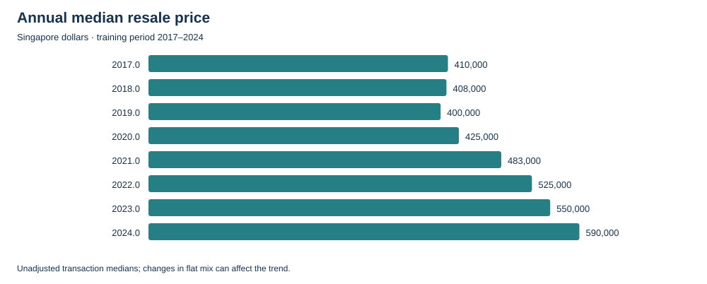
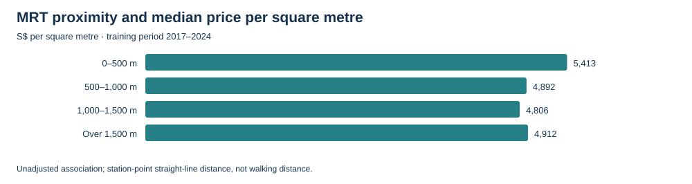
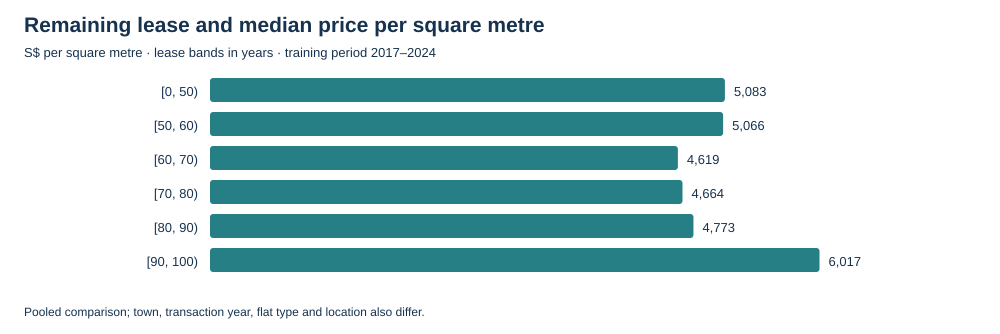
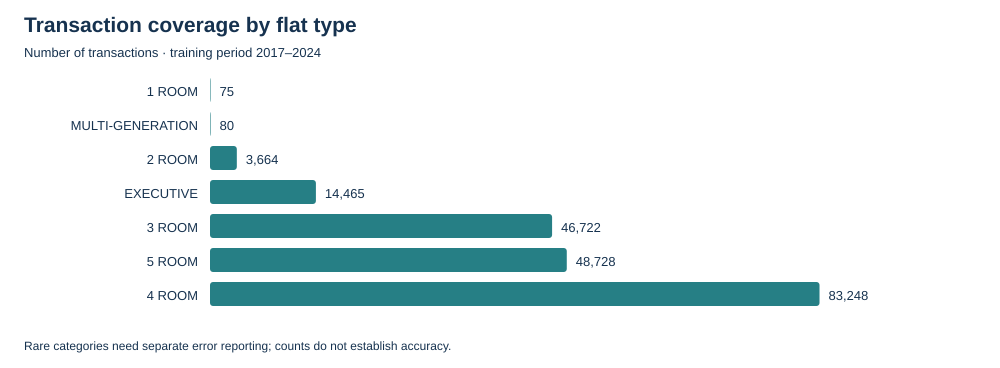
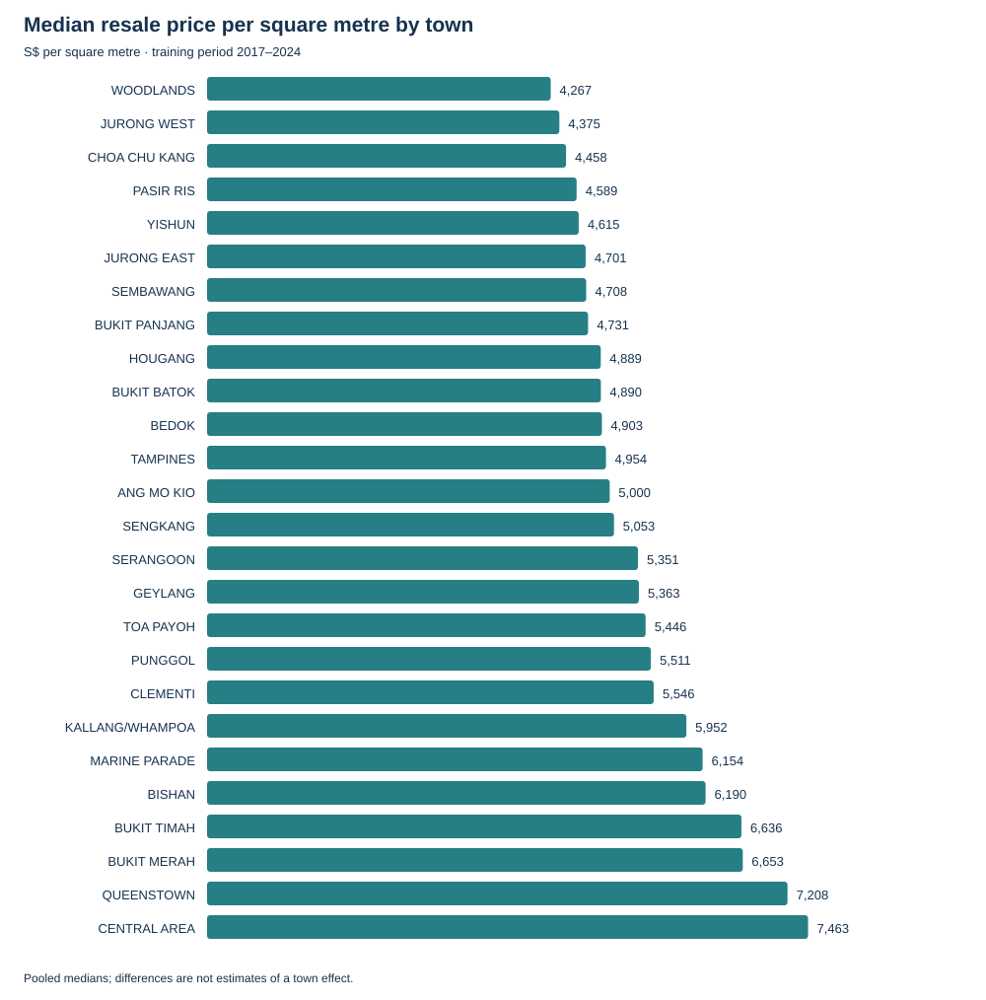

# Training-period exploratory findings

This analysis uses **196,982 registered transactions from January 2017 to December 2024**, covering 9,610 block/street addresses. All price exploration is restricted to training. Validation and final-test prices are not analysed. These are exploratory associations, not causal findings, statistical forecasts or validated model performance.

Reproduce with `python analysis/run_training_eda.py` after preparing the modelling dataset. Tables and provenance are in [reports/eda](../reports/eda); the script uses existing audit dependencies and generates standalone SVG charts without another plotting library.

## 1. Time is essential, and transaction mix matters

Annual median resale price was S$410,000 in 2017, S$400,000 in 2019 and S$590,000 in 2024. The 2017–2024 increase is about 43.9%. This is a comparison of transactions in each year, not appreciation of the same flat.

A simple composition sensitivity retains 86 town/flat-type cells with at least 30 transactions in every training year, applies fixed 2017 transaction weights, and averages their annual median prices. It covers 190,618 training transactions. That measure rises from approximately S$434,936 to S$610,314 (40.3%). Broad growth persists after fixing this part of the transaction mix, but differences in lease, size, floor, block and condition within cells remain. This is not HDB's official price index or a repeat-sales index.

**Modelling implication:** include transaction time and test stability in successive time windows. A model trained on historical levels cannot automatically extrapolate future market growth, especially beyond the training period. A tree model's time feature alone may not extrapolate that trend.

## 2. MRT proximity is worth testing; its contribution is not established yet

| Distance to operating MRT station proxy | Transactions | Median S$/m² |
|---|---:|---:|
| Up to 500 m | 56,616 | 5,413 |
| Over 500–1,000 m | 88,342 | 4,892 |
| Over 1,000–1,500 m | 36,257 | 4,806 |
| Over 1,500 m | 15,767 | 4,912 |

The pooled relationship is not uniformly decreasing with distance. Farther locations also have different lease profiles: median remaining lease is about 71.4 years within 500 m versus 85 years beyond 1,500 m. Location and flat mix differ too.

For a more comparable descriptive check, compare flats within 500 m with those over 1,000 m away, excluding the middle band. Require at least 20 near and 20 far transactions per stratum:

| Comparison groups | Eligible strata | Represented transactions | Weighted mean of within-stratum median S$/m² gaps |
|---|---:|---:|---:|
| Same town, flat type and year | 376 | 78,574 | +13.0% near vs far |
| Also same 10 m² area band and 10-year lease band | 210 | 26,904 | +16.3% near vs far |

Each gap is `(near median / far median - 1) × 100`; the mean weights each eligible stratum by its combined near/far transaction count. The median stratum gaps are 12.9% and 13.0%, respectively. Different restrictions retain different populations, so the second row is **not** a sequentially adjusted estimate on an identical sample. It represents only about 13.7% of all training transactions. Thresholds are exploratory, not tuned to obtain a particular result; no significance claims or population-wide premium are justified.

Centrality, amenities, floor, flat model, local demand and unrecorded condition remain possible explanations. Price per square metre is useful for description but does not fully adjust for size; the denominator itself can create relationships with floor area.

**Modelling implication:** retain distance as a candidate, compare models with/without it on the same validation records, and examine performance by coordinate confidence. The station location proxies use present-day geometry and documented historical availability assumptions; they are not verified historical entrances, walking distances or commute times.

Only 259 training transactions change distance by more than one centimetre under an additional one-month availability lag. This low count does not rule out anticipatory pricing or registration lag. A formal opening-event study would need appropriate comparison areas, pre-trend checks and attention to announcements; it has not been performed.

## 3. Lease and floor relationships need comparable groups

Pooled median S$/m² is about S$5,083 below 50 years of lease, S$4,619 at 60–70 years, and S$6,017 at 90–100 years. That uneven profile does not establish that a shorter lease adds value; the groups contain different locations and flats.

Within town/flat-type/year groups containing at least 30 transactions, calculate Spearman rank correlation between each feature and S$/m². Across 739 eligible groups:

| Feature | Median within-group correlation | Groups with positive correlation |
|---|---:|---:|
| Remaining lease years | 0.473 | 84.7% |
| Lower bound of reported floor range | 0.412 | 99.1% |
| Floor area | −0.265 | 21.4% |

These are unweighted summaries of group correlations, not independent observations, causal coefficients or predictive importance. Lease and floor can still correlate with finer location, model and condition. The area/S$/m² relationship is partly mathematical and does not imply that larger flats sell for less in total.

**Modelling implication:** retain lease, area and storey bounds; compare flexible versus simple relationships. Model gross transaction price, not S$/m², and assess whether patterns persist in held-out predictions. Avoid using lease commencement year and a derived age as if they were independent of remaining lease without considering redundancy.

## 4. Coverage limits need visible reporting

Training contains 83,248 four-room, 48,728 five-room and 46,722 three-room transactions, but only 75 one-room and 80 multi-generation transactions. These rare types cannot support confident granular conclusions. Keep them visible in analysis; any app restriction or fallback should follow validation evidence and be documented.

Town medians show substantial variation but pool eight years and different flat mixes. They support location-aware comparisons, not a ranking of the best places to buy. See town/year tables for the underlying support. Repeated source rows remain retained under the existing dataset policy; public records cannot establish whether they are separate sales or errors.

## Exploratory hypothesis register

| ID | Hypothesis | Evidence/status | Next test or dependency |
|---|---|---|---|
| H1 | Transaction time is related to price, with differing trends across towns/types. | Broad training-period level changes; town/year and type/year tables produced. Interaction strength not quantified. | Rolling validation; inspect subgroup errors and compare time representations. |
| H2 | Longer remaining lease is associated with higher prices among similar flats. | Positive within-group association in most eligible groups; pooled pattern is confounded. | Compare lease representations and interactions on validation, without causal interpretation. |
| H3 | MRT proximity adds predictive information beyond flat characteristics and location. | Positive near/far association in supported strata. Incremental prediction value remains untested. | Same-row validation ablation with/without distance and coordinate-confidence sensitivity. |
| H4 | MRT association varies by place and flat characteristics. | Detailed stratum gaps saved; heterogeneous sample support. No formal interaction test. | Inspect stable training subgroup patterns, then validate candidate interactions. |
| H5 | Higher storey ranges are associated with higher prices. | Positive S$/m² correlations in 99.1% of eligible groups. | Retain reported bounds; assess held-out errors across floor bands. |
| H6 | Older, established stations have a relationship with nearby housing prices beyond proximity. | **Not tested.** Pre-2017 actual opening dates have not been verified. Left-censored dates cannot measure age. | Research actual station and line-service opening dates before assessing this hypothesis. |
| H7 | Opening a station changes nearby price trends. | **Not tested.** Dated availability enables design, but no causal event study was conducted. | Separate study with comparison areas, announcements, pre-trends and uncertainty. |
| H8 | Rare types and newly represented blocks are harder to predict. | Coverage risk identified; prediction errors do not exist yet. | Report held-out errors and sample sizes; consider fallbacks if support is inadequate. |

An absent or weak observed station-age relationship would not prove no relationship exists. If properly tested station age offers no useful validation improvement, omit the age feature and keep the existing left-censored dates **as modelling-window availability markers**, not actual opening dates. We cannot make that decision from the present EDA.

## Decisions before modelling

- Proceed with training-only baseline development using the existing base feature allowlist and a separate MRT ablation.
- Freeze the final-test period. Do not use EDA or final-test errors to tune feature thresholds or select favourable subgroups.
- Fit preprocessing and comparable references inside each training window. Compare against a recent, past-only local median baseline before claiming ML value.
- Keep station age, historical bus/exit features and future forecasts outside the first model until their evidence is sufficient. Station-age research can be a separate feature extension; the current result does not dismiss it.
- Choose practical model acceptance criteria after measuring the baseline on development windows and before final-test evaluation. Report subgroup support, absolute dollar errors and uncertainty calibration separately.

## Repository organisation

`analysis/` holds executable EDA and its usage notes; `reports/eda/` holds generated aggregate tables, SVG figures and a manifest; this document holds interpretation and hypotheses. The existing `scripts/` remains responsible for acquisition/auditing/dataset preparation. No notebook, app or model artefact is claimed to exist. All charts and data summaries here come from the training snapshot, not external market commentary.
